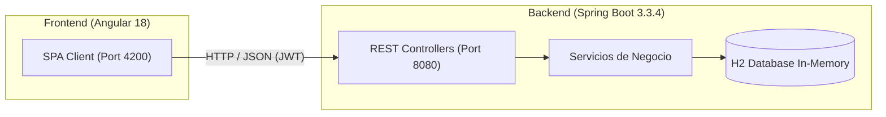

# InsecurePay - Laboratorio de Auditoría Forense y Remediación Web

> **ADVERTENCIA EDUCATIVA Y ÉTICA:**
> Esta aplicación web ha sido diseñada con **vulnerabilidades de seguridad intencionales** exclusivamente para fines pedagógicos en el curso **IF0009 - Desarrollo de Aplicaciones Web y Móviles** de la Universidad de Costa Rica.
> **Queda estrictamente prohibido desplegar este código en entornos de producción, redes públicas o utilizar las técnicas aquí descritas contra sistemas no autorizados.**

---

## 1. Descripción del Proyecto

**InsecurePay** es una plataforma fintech / billetera digital simplificada desarrollada con arquitectura desacoplada:
- **Backend:** Spring Boot 3.3.4 (Java 21 LTS), Spring Data JPA, H2 In-Memory Database, Spring Web, JJWT.
- **Frontend:** Angular 18 (Standalone Components, TypeScript, CSS3 responsivo).

La plataforma permite consultar saldos bancarios, transferir dinero entre cuentas y buscar movimientos transaccionales. Presenta múltiples fallas de seguridad pertenecientes al **OWASP Top 10:2021** para que los estudiantes ejecuten una **Auditoría Forense de Software** y su posterior **Remediación Defensiva**.



---

## 2. Requisitos Previos

Antes de ejecutar la aplicación, verifique tener instaladas las siguientes herramientas en su terminal:

```bash
# 1. Java Development Kit (JDK 21 o superior)
java -version

# 2. Node.js (v18.x o v20.x recomendado) y NPM (v9.x o superior)
node -v
npm -v

# 3. Git
git --version
```

---

## 3. Instrucciones de Clonación y Puesta en Marcha

### Opción A: Ejecución desde Visual Studio Code (Recomendada)

1. Abra Visual Studio Code.
2. Vaya a `Archivo` -> `Abrir espacio de trabajo desde archivo...` (`Open Workspace from File...`).
3. Seleccione el archivo:
   `unsecure_web_app_lab.code-workspace`
4. Abra la paleta de comandos (`Ctrl + Shift + P`) y ejecute:
   `Tasks: Run Task` -> `Start All (Backend + Frontend)`.
   *Esto iniciará automáticamente el backend en el puerto 8080 y el frontend en el puerto 4200 en terminales integradas.*

---

### Opción B: Ejecución desde Terminal (PowerShell / Bash)

#### Paso 1: Levantar el Backend (Spring Boot)

Abra una terminal en el directorio `backend`:

```powershell
cd backend

# En Windows (PowerShell / CMD) usando el wrapper de Maven:
.\mvnw.cmd spring-boot:run

# En Linux / macOS:
./mvnw spring-boot:run
```

*El backend quedará escuchando en `http://localhost:8080`.*

#### Paso 2: Levantar el Frontend (Angular)

Abra una **segunda** terminal en el directorio `frontend`:

```powershell
cd frontend

# Instalar dependencias npm (solo la primera vez)
npm install

# Iniciar servidor de desarrollo
npm start
```

*El frontend estará disponible en el navegador en `http://localhost:4200`.*

---

## 4. Cuentas de Prueba Preconfiguradas

La base de datos en memoria se inicializa con los siguientes usuarios de prueba:

| Usuario | Contraseña | Rol | Cuentas Asignadas |
| :--- | :--- | :--- | :--- |
| `admin` | `admin123` | Administrador del Sistema | Ninguna (gestión global) |
| `auditor_seguridad` | `audit2026` | Auditor Forense | Acceso de auditoría |
| `carlos_mora` | `carlos2026` | Cliente Bancario | `CTA-CR-1001` (Ahorros CRC), `CTA-CR-1002` (Dólares USD) |
| `maria_rojas` | `maria2026` | Cliente Bancario | `CTA-CR-2001` (Ahorros CRC) |
| `juan_perez` | `juan2026` | Cliente Bancario | `CTA-CR-3001` (Ahorros CRC) |

---

## 5. Acceso a la Consola de Base de Datos H2

Para inspeccionar las tablas (`USUARIOS`, `CUENTAS_BANCARIAS`, `TRANSACCIONES`):

1. Ingrese en el navegador a: `http://localhost:8080/h2-console`
2. Configure **exactamente** los siguientes parámetros de conexión:
   - **Driver Class:** `org.h2.Driver`
   - **JDBC URL:** `jdbc:h2:mem:insecure_pay_db` *(¡IMPORTANTE! No use `mem:testdb` ni `mem:medtriagedb`, debe coincidir con el nombre de la BD en `application.properties`)*
   - **User Name:** `sa`
   - **Password:** *(dejar en blanco)*
3. Haga clic en **Connect**.

---

## 6. Endpoints Clave para la Auditoría

| Método | Endpoint | Descripción | Vector de Auditoría |
| :--- | :--- | :--- | :--- |
| `POST` | `/api/auth/login` | Autenticación con JWT | Credenciales en texto plano / Weak Secret |
| `GET` | `/api/cuentas/{id}` | Consulta de cuenta por ID | Vulnerable a **IDOR / BOLA** |
| `GET` | `/api/cuentas/{id}/saldo`| Consulta directa de saldo | Vulnerable a **IDOR / BOLA** |
| `GET` | `/api/transacciones/buscar` | Búsqueda por término | Vulnerable a **SQL Injection (SQLi)** |
| `POST` | `/api/transacciones/transferir` | Ejecución de transferencia | Vulnerable a **IDOR** y **Stored XSS** |

---

## 7. Solución de Problemas Frecuentes (Troubleshooting)

### Error: `Database "mem:..." not found [90149-224]` en H2 Console
- **Causa:** El campo **JDBC URL** en la pantalla de login de H2 tiene un valor por defecto o un nombre de base de datos inexistente.
- **Solución:** Reemplace el texto de **JDBC URL** por:
  `jdbc:h2:mem:insecure_pay_db`

### Error: `Execution of script in powershell blocked (UnauthorizedAccess)`
- **Causa:** La política de ejecución de scripts de Windows restringe scripts locales.
- **Solución:** Ejecute en PowerShell como Administrador:
  `Set-ExecutionPolicy -ExecutionPolicy RemoteSigned -Scope CurrentUser`

### Error: `Port 8080 is already in use`
- **Causa:** Hay otra instancia de Tomcat o Spring Boot activa.
- **Solución (PowerShell):**
  `Get-Process -Id (Get-NetTCPConnection -LocalPort 8080).OwningProcess | Stop-Process -Force`

